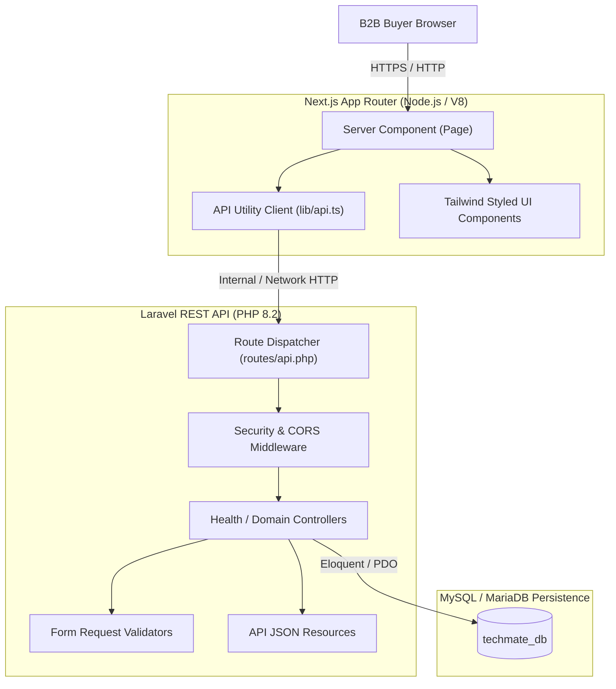

# Techmate Industries — System Architecture (Phase 1)

## 1. High-Level Architecture Overview

Techmate Industries adopts a decoupled, modern multi-tier web architecture:
- **Frontend Presentation Tier:** Next.js (React 19, App Router, TypeScript, Tailwind CSS) providing fast server-side rendering (SSR), search-engine indexability, accessibility, and high visual performance.
- **Backend Application Tier:** Laravel 11/12 REST API (PHP 8.2+) providing robust business logic, security middleware, request validation, structured JSON serialization, and extensible service contracts.
- **Database Persistence Tier:** MySQL 8.x / MariaDB database configured with `utf8mb4` encoding for rich international and symbol support, managed strictly through Laravel migrations.

---

## 2. Tier Details & Responsibilities

### 2.1 Next.js Frontend
- **App Router:** Employs the `src/app/` layout and page structure.
- **Server Components by Default:** Page components fetch data securely on the server side prior to rendering HTML. This protects API endpoints from unneeded public exposure, eliminates client-side flash of unauthenticated content, and delivers pre-rendered content for maximum SEO readiness.
- **Client Components where Required:** Dynamic interactive widgets (e.g. tabs, interactive modals, client-side ping meters) use `'use client'`.
- **Centralized API Client (`src/lib/api.ts`):** All HTTP communication passes through an abstraction that enforces typing, timeout handling, and graceful error fallbacks.

### 2.2 Laravel REST API
- **Stateless REST Design:** Endpoints under `/api/*` communicate strictly via standard JSON payloads.
- **Explicit Versioning & Routing:** Handled via Laravel's routing pipeline (`routes/api.php`).
- **Standardized Health Check (`GET /api/health`):** Serves lightweight system status without disclosing infrastructure secrets or credentials.
- **Exception Sanitization:** Unhandled server exceptions return sanitized JSON in production (`APP_DEBUG=false`), shielding database traces and environment variables from clients.

### 2.3 Persistence Layer (MySQL)
- **Database Name:** `techmate_db`
- **Portability:** Configured through environment variables (`DB_HOST`, `DB_PORT`, `DB_DATABASE`, `DB_USERNAME`, `DB_PASSWORD`). Local dev dynamically binds to detected port (e.g. `3308`), while production defaults to standard network configurations.
- **Schema as Code:** All tables, foreign keys, indexes, and migrations are tracked under `backend/database/migrations/`.

---

## 3. Communication & Data Flow

1. **User Request:** A commercial buyer requests `http://localhost:3000/`.
2. **SSR Execution:** Next.js executes the Server Component `page.tsx` on Node.js.
3. **Internal API Fetch:** `page.tsx` calls `getApiHealth()` in `src/lib/api.ts`, which dispatches an HTTP GET request to `http://127.0.0.1:8000/api/health`.
4. **Backend Processing:** Laravel receives the request, processes CORS headers, routes to `HealthCheckController`, runs health checks, and returns a 200 OK JSON response.
5. **HTML Assembly:** Next.js receives the JSON payload, formats the diagnostic cards and branding elements, and streams the finished HTML to the browser.
6. **Graceful Fallback:** If the Laravel API or MySQL service is down or rebooting, `getApiHealth()` catches network exceptions and returns a structured unavailable state. Next.js renders a helpful status alert while keeping the user experience intact without crashing.

---

## 4. Configuration Boundaries & Environment Hygiene

| Configuration Key | Frontend Scope | Backend Scope | Notes |
| :--- | :--- | :--- | :--- |
| `API_BASE_URL` | Server-only (`.env.local`) | N/A | Never expose via `NEXT_PUBLIC_*` unless client requests are needed |
| `NEXT_PUBLIC_APP_NAME` | Client & Server | N/A | Public branding identity |
| `APP_ENV` / `APP_DEBUG` | N/A | Private (`backend/.env`) | `production` / `false` in live environments |
| `DB_HOST` / `DB_PORT` | N/A | Private (`backend/.env`) | Configured per environment |
| `CORS_ALLOWED_ORIGINS` | N/A | Private (`backend/.env`) | Whitelists `http://localhost:3000` |

---

## 5. Deployment Boundaries (Local vs Production)

- **Local Development:**
  - Frontend: `http://localhost:3000` (`npm run dev`)
  - Backend: `http://127.0.0.1:8000` (`php artisan serve`)
  - Database: Local MySQL 8.x instance on port `3308`
- **Production Staging & Target:**
  - Frontend: Deployed on Node.js runtime / Vercel with HTTPS.
  - Backend: Deployed on Nginx / PHP-FPM / Laravel Cloud / Docker with PHP 8.2+.
  - Database: Managed MySQL / AWS RDS instance with private VPC peering and SSL certificates.
  - Cross-Origin: Restricted to verified domain `https://www.techmateindustries.co.in` (and staging URL).
