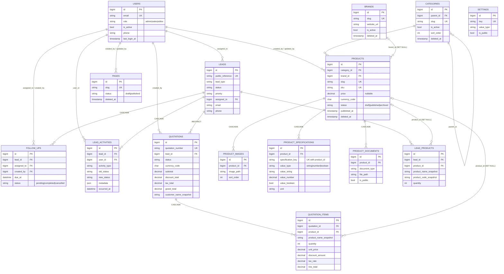

# Techmate Industries — Database Architecture & Schema Specification

## 1. Overview & Engine Specification
Techmate Industries utilizes MySQL 8.x / MariaDB as the persistence layer.
- **Database Name:** `techmate_db`
- **Character Set:** `utf8mb4`
- **Collation:** `utf8mb4_unicode_ci`
- **Port:** Configured via `DB_PORT` (detected on `3308` in this environment; defaults to standard `3306` on standard MySQL servers)
- **Source of Truth:** Managed strictly via Laravel migrations under `backend/database/migrations/`.

---

## 2. Phase 1 Foundation Tables

The following tables are currently created and verified via Laravel migrations:

### 2.1 `migrations`
Tracks executed schema versions and batches.
| Column | Type | Attributes |
| :--- | :--- | :--- |
| `id` | `int unsigned` | Primary Key, Auto Increment |
| `migration` | `varchar(255)` | Migration class / filename |
| `batch` | `int` | Execution batch index |

### 2.2 `users`
Prepared user identity table for administrative accounts. Phase 3 adds `phone`, `role`, `is_active`, `last_login_at` (see §3.2).
| Column | Type | Attributes |
| :--- | :--- | :--- |
| `id` | `bigint unsigned` | Primary Key, Auto Increment |
| `name` | `varchar(255)` | Full Name |
| `email` | `varchar(255)` | Unique Index |
| `email_verified_at` | `timestamp` | Nullable |
| `password` | `varchar(255)` | Bcrypt hash (rounds: 12) |
| `remember_token` | `varchar(100)` | Nullable |
| `created_at` / `updated_at`| `timestamp` | Nullable |

### 2.3 `password_reset_tokens`
Stores secure tokens for user password recovery.
| Column | Type | Attributes |
| :--- | :--- | :--- |
| `email` | `varchar(255)` | Primary Key |
| `token` | `varchar(255)` | Hash token |
| `created_at` | `timestamp` | Nullable |

### 2.4 `sessions`
Stores database-driven session records.
| Column | Type | Attributes |
| :--- | :--- | :--- |
| `id` | `varchar(255)` | Primary Key |
| `user_id` | `bigint unsigned` | Foreign Key / Index, Nullable |
| `ip_address` | `varchar(45)` | Nullable |
| `user_agent` | `text` | Nullable |
| `payload` | `longtext` | Serialized session data |
| `last_activity` | `int` | Index |

### 2.5 `cache` & `cache_locks`
Stores application-level cached fragments and distributed atomic locks.
- `cache`: `key` (`varchar(255)` PK), `value` (`mediumtext`), `expiration` (`int`)
- `cache_locks`: `key` (`varchar(255)` PK), `owner` (`varchar(255)`), `expiration` (`int`)

### 2.6 `jobs`, `job_batches` & `failed_jobs`
Asynchronous job queue foundation for sending background notification emails and processing quotation exports.

### 2.7 `personal_access_tokens`
Laravel Sanctum authentication tokens for future protected API clients and mobile sales portals.


---

## 3. Phase 3 Business Schema

Implemented by migrations `2026_10_28_000001` … `000015` in `backend/database/migrations/`. Verified on **MariaDB 10.4.32** (XAMPP, port from `DB_PORT`) — see §8. Orders, payments, invoicing, delivery, inventory and service tickets are intentionally **out of scope** until their workflows are approved.

### 3.1 Conventions

| Topic | Rule |
| :--- | :--- |
| Engine / charset | InnoDB, `utf8mb4`, `utf8mb4_unicode_ci` (from `config/database.php`). |
| Keys | `bigint unsigned` auto-increment `id` (Laravel `foreignId`). Internal IDs are never the public identifier. |
| Time | All timestamps are stored in **UTC** (`config/app.php` `timezone = UTC`). Convert to the viewer's timezone only in the presentation layer. Workflow instants use `timestamp`/`dateTime`; `issue_date` and `valid_until` are calendar `date`s. |
| Money | `DECIMAL` only. Prices `DECIMAL(12,2)`, amounts/totals `DECIMAL(14,2)`, tax rate `DECIMAL(5,2)` (percent). Currency is an ISO-4217 `CHAR(3)`. Application code handles money as **strings** (`App\Support\QuotationMath`), never floats. |
| Status values | `varchar` + a named `CHECK` constraint listing allowed values (portable, and easier to evolve than native `ENUM`). Allowed values are mirrored as constants on the models. |
| CHECK constraints | Added through `App\Support\SchemaChecks` on MySQL 8.0.16+ / MariaDB 10.2+. On other drivers (the default SQLite unit-test connection) they are skipped and the same rules are enforced in the model layer where noted. |
| Soft deletes | Only on catalogue/content: `categories`, `brands`, `products`, `pages`. **Not** on `leads`, `quotations` or their children, `users`, or settings. |

### 3.2 Tables

Column lists omit `id`, `created_at`, `updated_at` unless relevant. `UQ` = unique, `IX` = index.

#### `users` (extended — existing Laravel auth preserved)
Added columns: `phone varchar(30) null`, `role varchar(20) default 'sales'` (CHECK `admin|sales|editor`), `is_active boolean default 1`, `last_login_at timestamp null`. Existing `sessions`, `password_reset_tokens`, Sanctum tokens are untouched. `password` is hashed (cast) and `$hidden`; `role`, `is_active`, `last_login_at` are **not mass-assignable**. No public default grants access: the default role is the least-privileged staff role, and there are no public accounts. Soft deletes are deliberately not used; deactivate with `is_active = 0` (a reactivation needs the original row and history keeps its `user_id`).

> **Superseded in Phase 5:** `users.role` now holds `super_admin|catalogue_manager|sales_executive|sales_manager` (varchar(30), default `sales_executive`, migration `2026_10_30_000001`). `pages` gained `section` (`page|policy|faq|solution|service`) and `sort_order` (migration `2026_10_30_000002`). See `docs/admin-panel.md`.

**Access control approach (Phase 3 original):** three coarse roles on `users.role` — `admin` (everything, incl. user/role management), `sales` (leads, activities, follow-ups, quotations), `editor` (catalogue, pages). Enforcement belongs in Laravel Gates/Policies in the API phase; no RBAC package was added.

#### `categories`
`parent_id` (FK self, **RESTRICT**), `name 150`, `slug 160 UQ`, `description`, `image_path`, `meta_title 160`, `meta_description 320`, `is_active default 1`, `sort_order default 0`, `deleted_at`. IX `(parent_id, sort_order)`, IX `(is_active, sort_order)`.
*Self-parenting/cycles:* a CHECK may not reference an AUTO_INCREMENT column (MariaDB error 1901), so `Category::assertValidParent()` rejects a category being its own ancestor on save. Archive (soft delete) instead of deleting; RESTRICT blocks hard-deleting a parent with children.

#### `brands`
`name 150`, `slug 160 UQ`, `description`, `logo_path`, `website_url 255 null`, `is_active`, `sort_order`, `deleted_at`. IX `(is_active, sort_order)`. `Brand` rejects non-`http(s)` URLs (e.g. `javascript:`).

#### `products`
`category_id` (FK categories, **RESTRICT**), `brand_id` (FK brands null, **SET NULL**), `name 200`, `slug 220 UQ`, `sku 64 UQ`, `short_description 500`, `description longtext`, `price decimal(12,2) null`, `currency_code char(3) null`, `primary_image_path`, `status default 'draft'` (CHECK `draft|published|archived`), `is_featured`, `sort_order`, `published_at`, `created_by`/`updated_by` (FK users null, **SET NULL**), `deleted_at`.
CHECKs: `price >= 0` when present; `price` requires `currency_code`.
Indexes: `(category_id, status, sort_order)` category browsing (also serves the category FK); `(brand_id, status)` brand filter (serves the brand FK); `(is_featured, status, sort_order)`; `(status, published_at)`.
*Publication model:* one `status` column plus `published_at` (scheduled publishing) — no separate `is_active`/`is_published` flags. `Product::publiclyVisible()` = `status = published` AND `published_at` null-or-past AND not soft-deleted AND in an **active** category. `status`, `published_at`, `created_by`, `updated_by` are not mass-assignable (use `publish()` / `archive()`). Price is optional and indicative (quote-first B2B).

#### `product_images`
`product_id` (FK, **CASCADE**), `image_path`, `alt_text`, `caption`, `sort_order`. IX `(product_id, sort_order)`. Path/storage key only, never binary. **Ordering:** `sort_order` ascending, `id` as tie-breaker; the first image is the gallery lead. `products.primary_image_path` is the single authoritative "primary image", so there is deliberately no `is_primary` here (avoids two sources of truth).

#### `product_specifications`
`product_id` (FK, **CASCADE**), `specification_group 100 null`, `specification_key 100`, `specification_label 150`, `value_type` (CHECK `string|number|boolean`), `value_string 500`, `value_number decimal(14,4)`, `value_boolean`, `unit 20`, `sort_order`. **UQ `(product_id, specification_key)`**, IX `(product_id, sort_order)`.
*Mapping:* `string→value_string`, `number→value_number`, `boolean→value_boolean`; **exactly** the matching column is non-null — enforced by CHECK `value_matches_type` and mirrored in `ProductSpecification::saving`. A key may appear once per product regardless of group. Units (`mm`, `L`, `kW`, `°C`) live in `unit`. Validation of *which* keys/units are sensible (e.g. `power` ⇒ `kW`) is an application concern; no global definitions table was added (not needed yet).

#### `product_documents`
`product_id` (FK, **CASCADE**), `title 200`, `document_type` (CHECK `brochure|datasheet|manual|certificate|other`), `file_path`, `original_filename`, `mime_type`, `file_size_bytes unsigned bigint`, `language_code 10`, `sort_order`, `is_public default **0**`. IX `(product_id, is_public, sort_order)`. Private unless flagged; public catalogue code must use `Product::publicDocuments()`. File type/size/access validation happens at upload time in the application.

#### `leads`
`public_reference 24 UQ` (generated `TM-` + 10 random chars from an unambiguous alphabet), `lead_type default 'general'` (`general|product|quotation`), `customer_name 150`, `company_name`, `email null`, `phone null`, `alternate_phone`, `city`, `state`, `postal_code`, `country_code char(2)`, `subject`, `message`, `source 50` (free text, documented values: `website_form`, `phone`, `email`, `referral`, `other`), `status default 'new'` (`new|contacted|qualified|proposal|won|lost|spam`), `priority default 'normal'` (`low|normal|high|urgent`), `assigned_to` (FK users null, **SET NULL**), `last_contacted_at`, `closed_at`, `consent_at`.
CHECK: at least one of `email`/`phone` present. IX `(status, created_at)`, `(assigned_to, status)`, `(lead_type, status)`, `email`, `created_at`.
Only visitor-supplied fields are mass-assignable; `status`, `priority`, `assigned_to`, `public_reference`, `closed_at`, `last_contacted_at`, `consent_at` are set by trusted code. No payment or sensitive personal data is stored. Leads are never soft-deleted (retention is a policy decision, §7); there is no public list endpoint.

**Lead status transitions** (`Lead::TRANSITIONS`): `new → contacted|qualified|lost|spam` · `contacted → qualified|proposal|lost|spam` · `qualified → contacted|proposal|lost` · `proposal → qualified|won|lost` · `won → ∅` · `lost → contacted|qualified` (reopen) · `spam → new` (un-spam). `closed_at` should be set by the domain layer on `won|lost|spam`.

#### `lead_products`
`lead_id` (FK, **CASCADE**), `product_id` (FK null, **SET NULL**), `product_name_snapshot 200`, `product_code_snapshot 64 null`, `quantity unsigned default 1` (CHECK `> 0`), `customer_notes`. Indexes via the two FKs. No price column — enquiries carry none.

#### `lead_activities`
`lead_id` (FK, **CASCADE**), `user_id` (FK null, **SET NULL**), `activity_type` (`note|call|email|meeting|status_change|assignment`), `description text`, `old_status`, `new_status`, `metadata json null`, `occurred_at datetime` (when it happened, may be back-dated), plus `created_at` (when recorded). IX `(lead_id, occurred_at)`. **Append-only through Eloquent** (`updating`/`deleting` throw). `metadata` must not hold credentials/tokens. On MariaDB `json` is `longtext` with a `JSON_VALID` check.

#### `follow_ups`
`lead_id` (FK, **CASCADE**), `assigned_to`, `created_by` (FK users null, **SET NULL**), `title 200`, `description`, `due_at datetime`, `status default 'pending'` (`pending|completed|cancelled`), `completed_at`. IX `(assigned_to, status, due_at)`, `(status, due_at)`, `(lead_id, status)`.
**Overdue is derived** (`pending AND due_at < now()`, see `FollowUp::scopeOverdue`), not stored — a stored flag would need a scheduler and is wrong the instant the clock passes. When a lead closes, the domain layer should cancel its pending follow-ups; on reassignment, update `assigned_to`. No notification service in this phase.

#### `quotations`
`quotation_number 32 UQ` (generated `QT-YYYYMM-` + 6 random chars; a sequential per-year format is a business decision, see §7), `lead_id` (FK, **RESTRICT**), `status default 'draft'` (`draft|sent|accepted|rejected|expired|cancelled`), `currency_code char(3)`, `issue_date`, `valid_until null`, `subtotal`, `discount_total`, `tax_total`, `grand_total` (`decimal(14,2)` default 0), `customer_name_snapshot`, `company_name_snapshot`, `billing_address_snapshot`, `customer_email_snapshot null`, `customer_phone_snapshot null`, `terms_and_conditions`, `notes`, `created_by` (FK users null, **SET NULL**), `sent_at`, `accepted_at`, `rejected_at`.
CHECKs: totals `>= 0`; **`grand_total = subtotal − discount_total + tax_total`**; `valid_until >= issue_date`; email or phone snapshot present. IX `(lead_id, status)`, `(status, valid_until)`.
Status, totals and workflow timestamps are not mass-assignable. **Transitions** (`Quotation::TRANSITIONS`): `draft → sent|cancelled` · `sent → accepted|rejected|expired|cancelled` · `accepted|rejected|expired|cancelled → ∅`. `expired` is set by a (future) job when `valid_until` passes; a sent quotation is still immutable in content. Corrections are a **new** quotation.

#### `quotation_items`
`quotation_id` (FK, **CASCADE**), `product_id` (FK null, **SET NULL**), `product_name_snapshot 200`, `product_code_snapshot`, `description_snapshot`, `quantity unsigned` (CHECK `> 0`), `unit_price decimal(12,2)`, `discount_amount decimal(14,2) default 0`, `tax_rate decimal(5,2) default 0`, `tax_amount`, `line_subtotal`, `line_total`, `sort_order`. IX `(quotation_id, sort_order)`.
CHECKs: non-negative amounts; `0 ≤ tax_rate ≤ 100`; **`line_subtotal = quantity × unit_price − discount_amount`**; **`line_total = line_subtotal + tax_amount`**.

##### Quotation calculation (single method — `App\Support\QuotationMath`)
```
gross          = quantity × unit_price
line_subtotal  = gross − discount_amount          # fixed amount for the whole line; no percentage discounts
tax_amount     = round_half_up(line_subtotal × tax_rate / 100, 2)   # tax applies after discount
line_total     = line_subtotal + tax_amount

subtotal       = Σ gross            discount_total = Σ discount_amount
tax_total      = Σ tax_amount       grand_total    = subtotal − discount_total + tax_total
```
Rounding happens **once per line**, then lines are summed, so header and lines always reconcile to the cent. One currency per quotation (`quotations.currency_code`; lines have none). No tax jurisdiction or rate is assumed: `tax_rate` is supplied per line.
*Not enforceable by a row-level CHECK:* that the header totals equal the sum of the items. That requires the application to write the header and its items in **one transaction** using `QuotationMath` (a test covers the reconciliation).

#### `pages`
`title 200`, `slug 220 UQ`, `excerpt 500`, `content longtext`, `meta_title`, `meta_description`, `status default 'draft'` (`draft|published`), `published_at`, `created_by`/`updated_by` (FK users null, **SET NULL**), `deleted_at`. IX `(status, published_at)`. `Page::published()` hides drafts and future-dated pages. HTML in `content` must be sanitised **before** saving (no executable script/PHP). No other CMS exists in the repo, so the table is justified.

#### `settings`
`key 100 UQ`, `value text`, `value_type default 'string'` (`string|number|boolean|json`), `group 50`, `is_public default **0**`, `description`. IX `(is_public, group)`. Retrieval: `Setting::public()` for anything exposed to the website; group related keys with dotted names (`company.phone`, group `company`). **Never store secrets, credentials or tokens here**; those stay in `.env`/a secrets store. Not a substitute for relational data.

### 3.3 Foreign-key delete policy

| Child column → parent | On delete | Reason |
| :--- | :--- | :--- |
| `categories.parent_id → categories` | RESTRICT | A branch is archived, never orphaned. |
| `products.category_id → categories` | RESTRICT | Never lose catalogue items to a category deletion. |
| `products.brand_id → brands` | SET NULL | Products exist without a brand. |
| `products.created_by/updated_by`, `pages.*_by` → users | SET NULL | Content outlives its author. |
| `product_images/specifications/documents.product_id → products` | CASCADE | No retention value without the product (only fires on a hard delete; products are normally soft-deleted). |
| `lead_products.lead_id`, `lead_activities.lead_id`, `follow_ups.lead_id → leads` | CASCADE | Working data owned by the lead. Unreachable for any lead that has quotations (below). |
| `quotations.lead_id → leads` | **RESTRICT** | A lead with quotations can never be deleted. |
| `quotation_items.quotation_id → quotations` | CASCADE | Items belong to one header; headers are protected by the line above. |
| `lead_products.product_id`, `quotation_items.product_id → products` | SET NULL | History survives product removal via snapshots. |
| `leads.assigned_to`, `follow_ups.assigned_to/created_by`, `lead_activities.user_id`, `quotations.created_by → users` | SET NULL | Staff removal never erases sales history. |

### 3.4 ER diagram (matches the migrations)



---

### 3.x Phase 4 addition: `distributor_applications`

Added in `2026_10_29_000001`. Stores distributor/partner applications separately from `leads` because they carry territory (`regions_served` JSON), `business_type`, `experience_range` and a review workflow (`status` new/under_review/approved/rejected/withdrawn, `reviewed_by` SET NULL, `reviewed_at`, `internal_notes`). `public_reference` (prefix `DA-`) is UNIQUE. Public input can only populate applicant fields; status and review columns are set by trusted code. Indexes: `(status, created_at)`, `email`.

## 4. Snapshot, Retention & Consistency Rules

1. **Price changes** never touch issued quotations: `quotation_items.unit_price` is copied at quote time; nothing reads `products.price` afterward.
2. **Renames/SKU changes** never change history: `*_snapshot` columns on `lead_products` and `quotation_items`.
3. **Lead contact edits** do not rewrite quotations: the customer block is copied into `quotations.*_snapshot` when the quotation is created.
4. **Archived/deleted products**: soft-delete keeps the row (models use `withTrashed()` on those relations); a hard delete sets `product_id` to NULL and the snapshots remain.
5. **Staff deactivation/removal** keeps leads, activities, follow-ups and quotations (SET NULL; `is_active` is the normal path).
6. **One calculation method** — `QuotationMath` (§3.2).
7. **Status history** is recorded as `lead_activities` rows of type `status_change` with `old_status`/`new_status`; the activity table is append-only through Eloquent.
8. **Public identifiers** are non-sequential (`public_reference`, `quotation_number`) and unique at the database level.
9. **Transactions** are required (application layer) whenever a lead + its products, or a quotation + its items + totals, or a status change + its activity row are written. The database cannot enforce cross-row rules such as "header totals = Σ items" or "a status change must produce an activity row".
10. **Retention:** no automatic purge. Leads/quotations are retained until a documented policy is approved (a legal/privacy decision — assumed *retain, anonymise on request*). Do not substitute soft deletes for that policy. Hard-delete of a lead is only possible while it has no quotations.

**Rules enforced only in the application layer:** category cycles; allowed status transitions; spec key/unit sanity; email/phone *format*; URL safety (`Brand`); file type/size/access for images and documents; HTML sanitisation of `pages.content`; `settings` value validation; header-vs-items totals; cancelling follow-ups when a lead closes.

---

## 5. Architecture Decisions

- **Normalised specifications** (typed value columns + `unit`) instead of one JSON blob: filterable/sortable (`WHERE specification_key='capacity' AND value_number > …`), and units stay metadata. The API can still render grouped JSON from rows.
- **String + CHECK instead of native ENUM:** adding a status is a small migration, not a table rebuild; unit tests can run without CHECK support.
- **Single publication state** (`status` + `published_at`) rather than parallel booleans.
- **`DECIMAL` + per-line half-up rounding** so the stored totals are reproducible by anyone, to the cent.
- **Soft deletes only where an archive concept exists** (catalogue, content). Transactional records use RESTRICT/SET NULL + status fields.
- **Out of scope (until approved):** orders, payments, invoicing, delivery, inventory, service tickets, notifications/scheduler, multi-currency lines, tax tables, RBAC package.

---

## 6. Migration Guide

**Environment variables** (names only; values live in `backend/.env`, never committed): `DB_CONNECTION`, `DB_HOST`, `DB_PORT`, `DB_DATABASE`, `DB_USERNAME`, `DB_PASSWORD`, optional `DB_CHARSET`, `DB_COLLATION`.

```powershell
cd backend
php artisan about --only=environment             # app environment (no secrets printed)
php artisan tinker --execute="echo DB::getDatabaseName();"   # which database is actually configured
php artisan migrate:status                        # what has / has not run
php artisan migrate --pretend                     # preview the SQL
php artisan migrate                               # apply pending migrations (additive)
php artisan migrate:rollback --step=15            # DEV ONLY: undo the 15 Phase 3 migrations
php artisan db:seed                               # local/testing only: "Sample" rows (see below)
```
Never run `migrate:fresh`, `db:wipe` or `migrate:reset` against a database that holds data. A migration that has already run must not be edited; add a new migration instead.

**Tests**
```powershell
cd backend
php artisan test                                  # fast suite on in-memory SQLite (CHECK-constraint tests are skipped)
vendor/bin/phpunit -c phpunit.mysql.xml           # full suite on a real MySQL/MariaDB
```
`phpunit.mysql.xml` uses the database `techmate_test`, with host/port/user/password taken from `.env`. Create it once: `CREATE DATABASE techmate_test CHARACTER SET utf8mb4 COLLATE utf8mb4_unicode_ci;`. `tests/DatabaseTestCase.php` aborts if the database name does not end in `_test`, because `RefreshDatabase` wipes it.

**Seeding:** `DatabaseSeeder` seeds nothing in production. In `local`/`testing` it runs `DevelopmentSampleSeeder` (idempotent, every row labelled "Sample", example.test addresses, random unprinted admin password). It invents no products, prices, specifications or customers.

---

## 7. Assumptions & Open Decisions

- Quotation numbers are random (`QT-YYYYMM-XXXXXX`). If finance needs gap-free sequential numbers, add a counter table updated inside the issuing transaction — a business decision.
- Lead retention/erasure period and consent wording are pending legal input.
- Role names (`admin|sales|editor`) are a minimal assumption; the permission matrix is defined in the API phase.
- Tax: per-line `tax_rate`, no jurisdiction logic. Currency: free ISO code per quotation/product.
- `leads.email` is nullable (phone-only enquiries are legitimate); email-format validation is the API's job.

## 8. Verification Status

Run against MariaDB 10.4.32: all 15 migrations applied to a disposable `techmate_test` database and to the development `techmate_db`; rollback of all 15 and re-apply passes on `techmate_test`; 43 tests / 186 assertions pass. **MySQL 8 itself has not been tested** (no instance available); the SQL used (named CHECK constraints, `DROP CONSTRAINT`) is valid on MySQL 8.0.19+, but CHECK also forbids columns used in `SET NULL`/`CASCADE` FK actions there — none of the constraints reference such columns.
